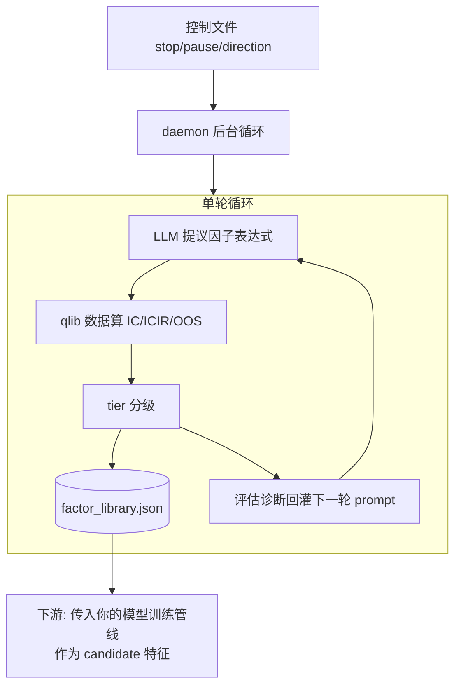

# Factor Factory 因子工厂

**中文** | [English](README_EN.md)

LLM 驱动的 A 股 alpha 因子自动挖掘流水线。灵感来自微软 [RD-Agent](https://github.com/microsoft/RD-Agent)（NeurIPS 2025），但目标相反：**不追求大而全的科研框架，只做一台拎包即用的"因子生产机器"**。

```
LLM 提议 Qlib 因子表达式 → 真实 A 股数据算 IC → 达标自动入库 → 评估结果回灌下一轮 → 全天候循环
```

## 为什么是它

| 对比 | R&D-Agent-Quant | **Factor Factory** |
|---|---|---|
| 定位 | 科研框架（重） | 生产机器（轻）：核心循环几百行 |
| 运行方式 | 手动跑实验 | **daemon 全天候**，文件协议控制（stop/pause/direction） |
| 入库标准 | 论文级评估 | IC/ICIR/OOS 三重硬门槛自动分级（strong/candidate） |
| 生态 | 通用 | A 股本土化：qlib 表达式、中证级股票池、中文因子诊断 |

## 快速开始（约 10 分钟）

```bash
# 0) 前置：一份 qlib 格式的 A 股日线数据（微软 Qlib 的 dump 格式，兼容 ~/.qlib/cn_data）
#    没有数据？参考 Qlib 官方文档 dump，或用任意 qlib 数据源

# 1) 安装
pip install -e .

# 2) 配置 LLM（任一 OpenAI 兼容端点）
cp .env.example .env    # 填 LLM_API_KEY / LLM_BASE_URL / 模型名
set -a; source .env; set +a

# 3) 放入种子因子（可选，含 3 条 qlib Alpha158 公开因子样例）
mkdir -p ~/.factor_factory
cp seeds/factor_library.seeds.json ~/.factor_factory/factor_library.json

# 4) 跑一轮完整 R&D 循环（或启动全天候 daemon）
python -c "
from factor_factory.agent import FactorAgent
fa = FactorAgent()
fa.run_research_loop(n_iter=1, factors_per_iter=5)
"
cat ~/.factor_factory/factor_library.json   # 新因子已入库
```

## 全天候 daemon（推荐）

```bash
./scripts/factor_factory.sh start     # 后台常驻：每轮 15 因子，日上限 16 轮
./scripts/factor_factory.sh status    # 状态
./scripts/factor_factory.sh stop      # 停止（文件协议：写 stop 文件）
tail -f ~/.factor_factory/factor_factory.log
```

控制全部基于文件信号，无锁无数据库：`factor_factory.stop` / `.pause` / `.direction.txt`（指定挖掘方向，覆盖 LLM 自动诊断）。

## IC 分级门槛（默认，可调）

| tier | 条件 | 含义 |
|---|---|---|
| strong | IC≥0.02 且 ICIR≥0.3 且 OOS占比≥70% 且 ≥2 个预测 horizon | 可进入模型训练候选 |
| candidate | IC≥0.015 且 ICIR≥0.2（放宽版） | 观察名单 |

`IC = 日截面 Pearson corr(因子值, 次日收益)`；评估用真实 A 股日线（qlib），滚动窗口防前视。

## 因子库 Schema

```json
{
  "expr": "($close/Ref($close,1)-1)/(Std($close/Ref($close,1)-1,60)+1e-12)",
  "name": "MOM_REV60",
  "source": "discovered",
  "tier": "strong",
  "ic_mean": 0.031, "icir": 0.41, "ic_std": 0.076,
  "n_days": 1200, "oos_ratio": 0.72,
  "model_coverage": {"deep": 3, "quick": 8}
}
```

`seeds/factor_library.seeds.json` 提供 3 条 [qlib Alpha158](https://github.com/microsoft/qlib) 公开因子作为起步样例（KUP / HIGH0 / RESI5）。

## 架构



## 配置

全部通过环境变量（见 `.env.example`）：`FF_HOME`（工作目录，默认 `~/.factor_factory`）、`FF_DATA_DIR`（qlib 数据，默认 `~/.qlib/cn_data`）、LLM 四件套。

## 设计说明

- **LLM 提议、数据裁决**：LLM 只负责"假设生成+结果解读"，准入由硬性 IC 门槛决定——LLM 无法说服统计。
- **诊断回灌**（"推理即梯度"）：每轮失败因子的量化诊断注入下一轮 prompt，收敛快于随机搜索。
- **文件协议**：控制信号是文件而非 socket/DB——`rm` 即停止，`cat` 即配置，crash-safe。
- **预取直调**：数据拉取是确定性 Python 代码，LLM 不碰数据获取路径，幻觉无法污染 IC。

## 免责声明

本项目仅供量化研究与技术学习，不构成任何投资建议。股市有风险，因子会失效——IC 高不代表明天赚钱。

## License

MIT
